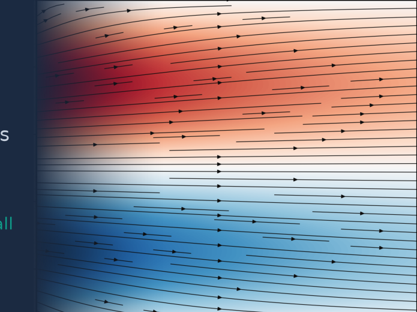
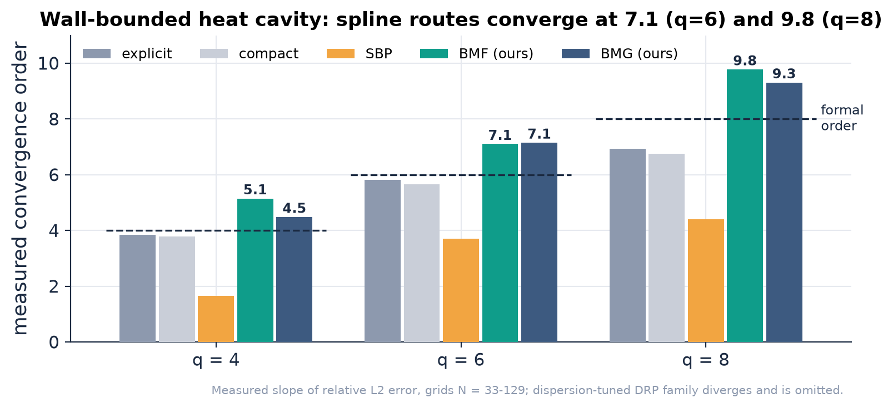
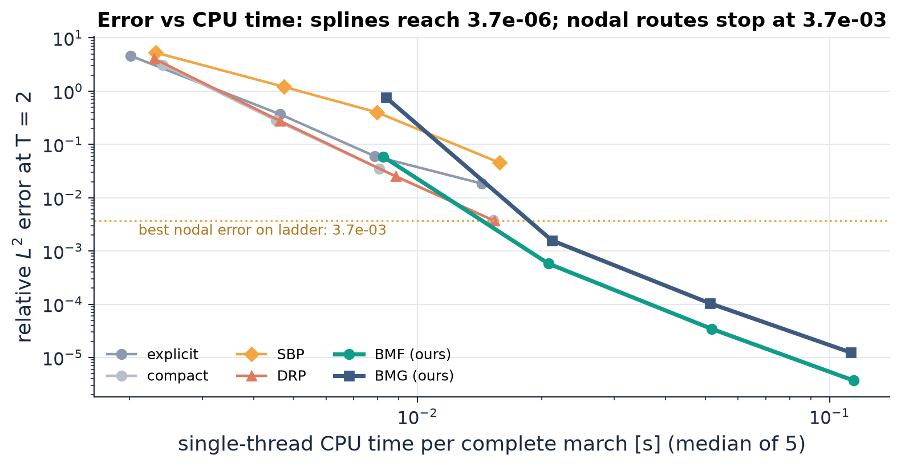
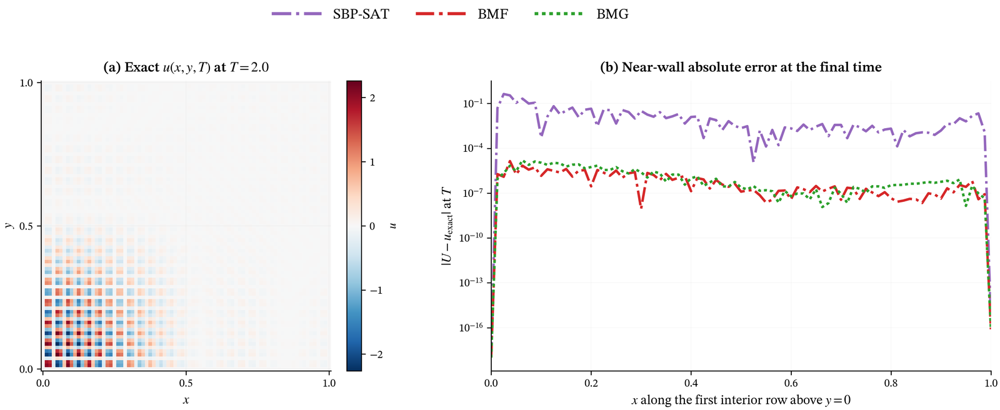
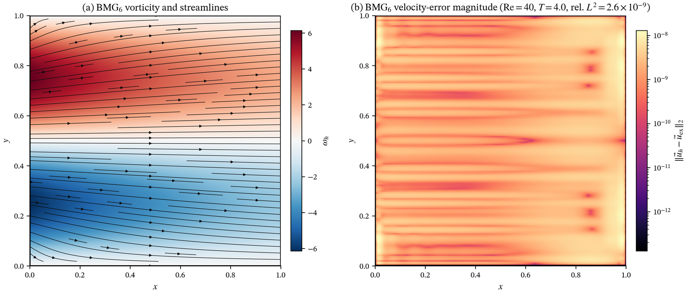
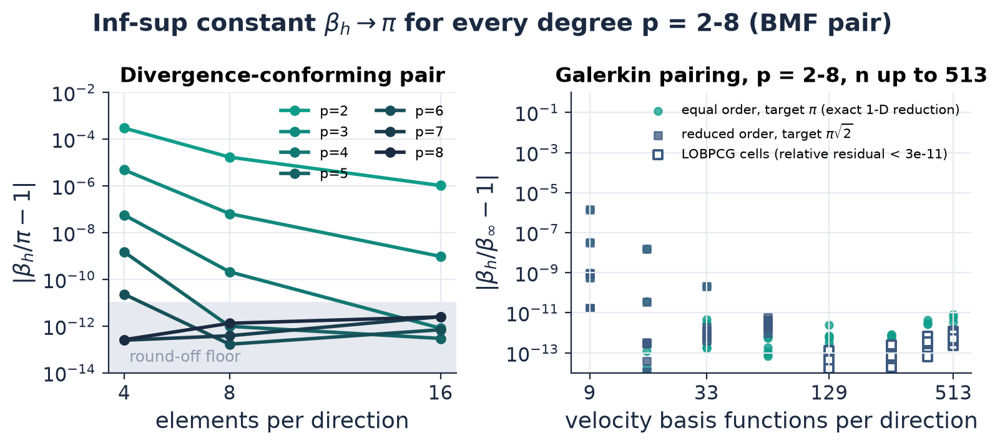
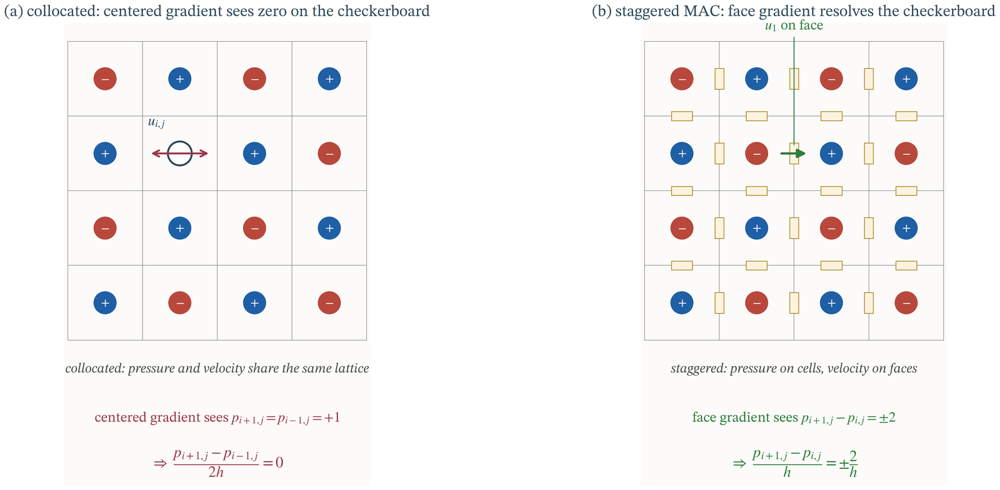
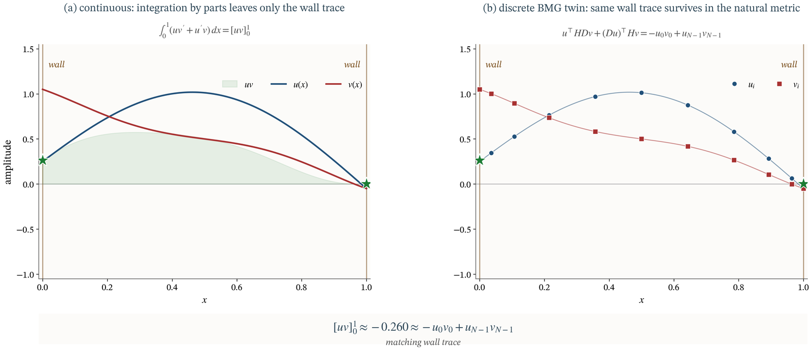

<p align="center">
  
</p>

# energy-stable-sbp-closures

[](https://github.com/bay-yearick-lab/energy-stable-sbp-closures/actions/workflows/tests.yml)
[](LICENSE)
[](pyproject.toml)
[](paper/README.md)
[](lean/README.md)

Yong Yi Bay and Kathleen A. Yearick

Provably energy-stable, high-order wall closures for CFD and thermal-fluid problems, built from one clamped B-spline space instead of tuned closure coefficients. The closures keep formal order at the wall, conserve mass, momentum and energy to round-off, and give an inf-sup-stable pressure with no checkerboard mode. After six wall transits of closed-box acoustics at sixth order they are 1.6 x 10<sup>5</sup> more accurate than the strongest stable published compact closure.

A physical wall removes the mirror neighbour of every centred stencil, which is where high-order PDE discretizations usually lose stability, conservation or order. Here the bounded operator is the periodic (cardinal) interior plus an endpoint block whose size depends on the spline degree p, not on the grid. Two operators come out of the same space: BMF, a staggered gradient-divergence pair, and BMG, an isogeometric finite element (B-spline Galerkin) derivative in the spline mass metric. Both satisfy exact summation-by-parts (SBP) identities.

## Results

| Test | Measured result |
| --- | --- |
| Long-time stability, closed-box acoustics, q = 6, six wall transits | BMF 8.2e-9, BMG 2.5e-8; strongest stable published compact closure 1.3e-3; classical SBP 5.8e-2; order- and dispersion-tuned closures diverge within one transit |
| Reflected acoustic packet, N = 97 | spline error lower than the best stable competitor by 408x, 983x and 7,791x at q = 4, 6, 8 |
| Convergence rate, wall-bounded heat cavity | BMF 5.1 / 7.1 / 9.8 at formal order 4 / 6 / 8; classical SBP 1.6 / 3.7 / 4.4 |
| Accuracy vs wall-clock, heat cavity | splines reach 3.7e-6; all nodal routes stay above 3.6e-3 on the same grid ladder |
| Wall derivative, flux and traction vs optimized spectral elements | spline lower error in 47/48, 47/48 and 45/48 resource cells; median factors 4.9x, 4.8x, 4.2x |
| Incompressible cavity vs mixed spectral elements, Re = 1000 | at matched error 0.02, spectral elements need 1.43x the state, 1.52x the saddle-point iterations and 1.28x the run time |
| Steady analytic Navier-Stokes wake, Re = 40, 25 x 25 grid | BMG velocity error 2.7e-9; a sixth-order compact scheme needs about 15x the degrees of freedom to approach it |
| Discrete conservation (all balances, p = 2 to 8) | worst relative residual 4.8e-15; post-projection divergence 4.4e-14; 28-cell cavity matrix: divergence 7.8e-16, energy ledger 1.5e-12 |
| Inf-sup constant, divergence-conforming pair (p = 2 to 8, 4/8/16 elements) | one pressure null (the constant) in all 21 cells; at 16 elements \|β_h/π − 1\| = 1.0e-6 (p = 2), 9.7e-10 (p = 3), ≤ 2.5e-12 (p = 4 to 8) |
| Inf-sup sweep with matrix-free LOBPCG (p = 2 to 8, up to 513 basis functions per direction) | 112 cells, every cell within 1.5e-6 of its limit π or π√2; relative eigen-residual ≤ 2.8e-11; whole sweep 246 s on 4 CPU threads |
| Memory footprint, p = 6, N = 4097 | banded M, K and LU take 1.3 MB vs 134 MB dense |

<p align="center"></p>

**Figure 1.** Measured convergence order of the relative L² error on a wall-bounded heat cavity, grids N = 33 to 129. Dashed lines mark the formal order. The spline routes keep (and exceed) formal order at the wall; classical SBP closures lose about two orders.

<p align="center"></p>

**Figure 2.** Relative error against CPU time for a complete heat-cavity march (assembly included, median of five runs, each family at its own stable step). Below roughly 4e-3 error the splines are the only routes on the tested ladder.

<p align="center"></p>

**Figure 3.** Sixth-order heat cavity at T = 2. Left: exact solution evolved from a high-wavenumber band (modes 26 to 30), 81 x 81 points. Right: absolute error along the first interior row above the wall. The SBP-SAT closure sits between 1e-4 and 1e-1; BMF and BMG stay between 1e-8 and 1e-5.

<p align="center"></p>

**Figure 4.** Unforced steady wake on the unit square, Re = 40, q = 6, 25 x 25 points. Left: BMG vorticity and streamlines. Right: pointwise velocity error, at the 1e-9 level across the domain.

<p align="center"></p>

**Figure 5.** Discrete inf-sup constant. Left: the divergence-conforming BMF pair, relative distance of β_h from π against element count; p ≥ 4 reaches the round-off floor by 8 elements. Right: Galerkin velocity-pressure pairing up to 513 basis functions per direction. Equal order reduces exactly to a 1-D eigenproblem through the Kronecker structure; reduced order is solved with matrix-free LOBPCG on the whitened Kronecker operator, preconditioned by the generalized 1-D pencil (open markers), and cross-checked against dense solves.

<p align="center"></p>

**Figure 6.** Why the staggered placement matters. A collocated centred gradient does not see the checkerboard pressure mode; the staggered face gradient does. In the BMF spline complex the pressure Schur complement has kernel exactly span{1}, so no checkerboard, wall-localized or knot-scale pressure mode survives.

<p align="center"></p>

**Figure 7.** The continuous integration-by-parts identity (left) and its exact discrete counterpart for BMG in the spline mass metric (right). Only the wall trace survives in both, which is what makes the energy estimate, and therefore stability, hold for the discrete operator.

## How it works

**Clamped B-spline space.** An open-uniform knot vector with (p+1)-fold end knots gives a basis that interpolates the wall values. The coefficient pencil splits into the cardinal Toeplitz interior of the periodic method plus an endpoint algebra of size O(p). The number of wall transfer channels (8p − 6 for the BMG pencil) is proved for every p ≥ 2 once N ≥ 4p − 2 and does not grow with resolution.

**SBP and Green identities.** With mass matrix H and derivative D, both routes satisfy uᵀHDv + (Du)ᵀHv = −u₀v₀ + u_{N−1}v_{N−1}. The second-derivative closures are compatible with the first-derivative ones, so the discrete Green cancellation holds at the wall for Dirichlet, Neumann and Robin data, and the energy method gives stability without artificial dissipation.

**Staggered (BMF) and Galerkin (BMG) formulations.** BMF places pressure in the derivative space of degree p − 1 and velocity in the degree-p space, which gives an exact discrete de Rham sequence: a staggered gradient-divergence pair with exact mass conservation, pressure-work cancellation and a kinetic-energy balance for the nonlinear terms. BMG is a same-grid finite element derivative in the natural spline metric, used for wave propagation.

**Inf-sup stability.** The constant shown here is the mass-metric (L² velocity, L² pressure) divergence constant used by the pressure projection, β_h = inf over mean-zero q_h of sup over v_h of (q_h, div_h v_h) / (‖v_h‖_{L²} ‖q_h‖_{L²}). It is not normalized to be at most 1: on the unit square its continuous value is π, the square root of the first nonzero Neumann Laplacian eigenvalue π². For the divergence-conforming pair the paper proves β_h ≥ π for every fixed p and β_h → π as h → 0, and the pressure Schur complement has the constant as its only null vector.

**Matrix-free preconditioned eigensolver.** The 2-D pressure operator is a Kronecker sum A_x ⊗ R_z + R_x ⊗ A_z and is never formed. Operator applications are dense 1-D products, the projection solve uses fast diagonalization of the two 1-D pencils, and the smallest eigenvalues come from LOBPCG preconditioned by the generalized 1-D pencil, with 1-D condition numbers up to 1.2e7 at p = 8, n = 513.

**Sparse direct solvers.** M, K and their LU factors are banded with O(Np) storage. In d dimensions each operator application is d·N^(d−1) independent line solves. At p = 6, N = 4097 a banded mass solve takes 62 µs per line and a K application 21 µs, single thread.

**Formal verification.** The finite, exactly computable parts of the construction (Greville nodes, the coefficient forms M and K, the coefficient-space Green identity, the degree-two transfer count) are proved in Lean 4 with Mathlib: 76 theorems, no `sorry`.

## Where things live

| Component | Implementation |
| --- | --- |
| Clamped open-uniform knots, Greville nodes, B-spline mass and advection forms | `code/boundary_spline_analysis.py` (`open_uniform_knots`, `greville_from_knots`, `bspline_mass_and_advection`) |
| BMG derivative D and spline mass metric H (SBP: HD + DᵀH = B) | `code/boundary_spline_analysis.py` (`bmg_nodal_operator`, `BoundaryBMG`) |
| BMF staggered gradient-divergence pair (degree p and p − 1) | `code/boundary_spline_analysis.py` (`bmf_staggered_operators`, `bmf_staggered_sbp_residual`) |
| Divergence-conforming 2-D pair, pressure projection, inf-sup constant, Schur-complement kernel | `code/bmf_hdiv_projection.py` (`BMFHDivProjection2D.project`, `.beta`, `.kernel_certificate`) |
| Independent inf-sup certificate (SciPy `BSpline` only) | `code/check_bmf_hdiv_projection.py` |
| Matrix-free LOBPCG inf-sup sweep on the whitened Kronecker operator | `code/make_infsup_sweep.py` |
| Coefficient-space tensor operators for compatible flow | `code/tensor_compatible_flow.py`, `code/bmf_hdiv_ns2d.py`, `code/bmf_ns2d.py` |
| Banded C++ operator stack, fast-diagonalization pressure solve, cavity solver | `code/cavity/include/` (`bspline.h`, `linalg.h`, `wall2d.h`, `wall_ns2d.h`), `code/cavity/apps/` |
| Degree-sized wall-transfer channels (8p − 6) | `code/universal_wall_transfer.py`, `code/all_degree_wall_rank.py` |
| Competitor families: explicit, compact, SBP-SAT, DRP, published conservative stable closures, spectral elements | `code/boundary_spline_analysis.py`, `code/baseline_closures.py`, `code/sem_operator.py` |
| Heat cavity (convergence, cost) | `code/heat_cavity_core.py`, `code/s6_heat_cavity_convergence.py`, `code/s6_wallclock_cost.py` |
| Closed-box acoustics and reflected packets | `code/s6_wall_longtime_cliff.py`, `code/s6_packet_reflection.py` |
| Steady analytic wake, lid-driven cavity | `code/s6_analytic_wake.py`, `code/cavity_compatible_comparator.py` |
| Lean 4 proofs (knots, Greville nodes, M and K, Green identity, wall rank at p = 2) | `lean/BsplineBoundary/` |

## Layout

```
energy-stable-sbp-closures/
├── code/             operators, experiment drivers (s2_* to s6_*), figure scripts (make_*), verifiers
│   ├── cavity/       C++ header-only banded B-spline stack and cavity/benchmark apps
│   ├── data/         published coefficient tables and small cavity run summaries
│   └── results/      JSON/CSV result files that rebuild every figure
├── tests/            pytest numerical-validation suite
├── benchmarks/       cost-accuracy and operator-cost benchmarks with result tables
├── lean/             Lean 4 proofs (Lake project)
├── paper/            manuscript status
├── assets/           README figures
├── tools/            make_readme_assets.py, lab.mplstyle
├── Makefile, pyproject.toml, uv.lock, LICENSE, CITATION.cff
```

## Reproducing

```bash
git clone https://github.com/bay-yearick-lab/energy-stable-sbp-closures.git
cd energy-stable-sbp-closures
uv sync --group dev                       # numpy, scipy, matplotlib, pytest; Python 3.10+

uv run make verify                        # SBP residuals, inf-sup constants, convergence orders
uv run make test                          # pytest numerical-validation suite
uv run make test-all                      # full regression suite (unit tests and artifact verifiers)
uv run make benchmark                     # cost-accuracy benchmark, heat cavity q = 6
uv run python code/make_infsup_sweep.py   # 112-cell inf-sup sweep, about 4 min on 4 threads
uv run make figures                       # rebuild the README result cards from code/results/
```

`make verify` takes about 15 s on one laptop core and prints (inf-sup rows at 4 and 8 elements omitted here):

```
1. Summation-by-parts identity, max |H D + D^T H - B|
    p    N        BMG        BMF
    2   17    9.5e-15    3.3e-16
    3   21    1.6e-14    3.3e-16
    4   25    2.0e-14    5.6e-16
    5   29    2.8e-14    8.9e-16
    6   33    3.4e-14    8.9e-16
    7   37    6.6e-14    8.9e-16
    8   41    6.5e-14    8.9e-16

2. Inf-sup constant of the divergence-conforming BMF pair (limit pi)
    p elements             beta_h  |beta_h/pi-1| nulls
    2       16  3.141595923118676       1.04e-06     1
    3       16  3.141592656621470       9.65e-10     1
    4       16  3.141592653592451       8.46e-13     1
    5       16  3.141592653589758       1.10e-14     1
    6       16  3.141592653589897       3.33e-14     1
    7       16  3.141592653590008       6.86e-14     1
    8       16  3.141592653589792       4.44e-16     1

3. Heat-cavity convergence order (fit on N = 81, 97, 129)
    q family  order  rel L2 at N=129
    4    BMF   5.15         9.03e-09
    4    BMG   4.48         1.72e-08
    4    SBP   1.65         1.81e-04
    6    BMF   7.10         1.56e-11
    6    BMG   7.15         2.35e-11
    6    SBP   3.71         6.32e-05
    8    BMF   9.77         2.67e-14
    8    BMG   9.31         3.74e-14
    8    SBP   4.41         1.53e-05

PASS
```

Large production runs (cavity flows, frontier selections) write their summaries to `code/results/`, and the committed JSON files rebuild every figure without rerunning them. Figure drivers write to `figures/`.

## Citation

```bibtex
@unpublished{bay2026boundary,
  author = {Bay, Yong Yi and Yearick, Kathleen A.},
  title  = {Boundary {B}-Spline Mimetic Schemes: Degree-Sized Wall Algebra,
            Spectral-Like Resolution, and Compatible Flow},
  year   = {2026},
  note   = {In preparation}
}
```

## License

MIT. See [LICENSE](LICENSE).
